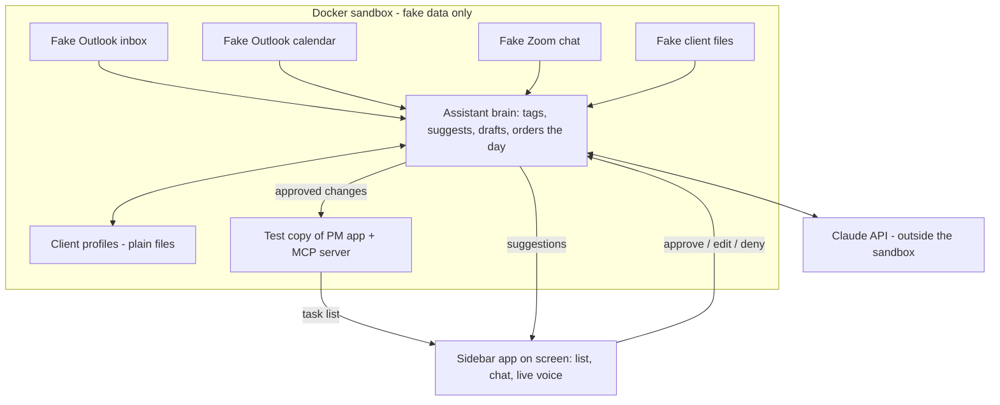

# AI Work Assistant: Proof of Concept Build Brief

This brief is the complete handoff from the planning conversation. It holds everything decided so far. Read all of it before planning. The architecture doc with diagrams is here: https://claude.ai/artifact/AZZC6P84J8ArxFziHdaV4a

---

## How to run this build (read first)

**Kickoff prompt to paste into Claude Code, from the root of the PM app repo:**

> Read POC_BRIEF.md in full. Follow its "Build process" section exactly: plan with a Fable 5.2 subagent, show me the plan, and wait for my approval before building anything.

### Build process

1. **Plan with Fable 5.2.** Spawn one planning subagent with `model: fable`. It reads this brief and the PM app codebase, then writes the plan to `tasks/todo.md` as checkable items. The plan must cover:
   - How the PM app works today: its data model, API, and how clients and tasks are stored.
   - What the sandbox needs from the PM app: a test copy and database, plus an MCP server exposing only the allowed actions (below).
   - The build order, with which pieces can be built in parallel.
   - A test or check for every piece, and an end-to-end check of the demo script.
   - Any decision it could not make from this brief, listed as a question for the user.
2. **Stop and check in.** Show the user the plan. Build nothing until they approve it.
3. **Build with Opus 5.5.** Spawn builder subagents with `model: opus`, one focused piece per subagent, in parallel where pieces don't depend on each other. Mark items done in `tasks/todo.md` as they finish.
4. **Verify independently.** A separate `model: opus` subagent that did not build the code runs the full demo script end to end and reports what fails. Fix failures, then verify again.
5. **Write up.** Add a review section to `tasks/todo.md`: what works, what doesn't, and what to do next.

### Working rules

- Simplicity first. Smallest change that does the job. Touch only what's necessary in the PM app.
- No temporary fixes. Find root causes.
- Never mark something done without proving it works.
- If something goes sideways, stop and re-plan instead of pushing on.
- After any correction from the user, add the pattern to `tasks/lessons.md` with a rule to prevent it. Review that file at the start of each session.
- **Never connect to real Outlook, Zoom, the real file server, or the live PM app database.** Fake data only.

---

## The product in one paragraph

An always-on assistant that reads all of your work context (email, chat, calendar, client files), triages your day into a guided task list, prepares analyst-level first drafts of everything, and always routes its work through your approval. Every task becomes "review, approve, next" instead of "what do I do now?" Claude reads every item live with the client's context. It is not a rules engine or a formula. Nothing is sent or changed without approval.

---

## Proof of concept scope

### Environment

- Runs in a **Docker sandbox on a work laptop.** It must have no access to real systems: no Outlook login, no file server mount, no live PM database. (The user should check with IT that Docker is allowed.)
- **Only Claude sits outside the sandbox,** reached through the Claude API.
- Everything else is fake data.

### What goes in the sandbox

| Piece | What it is |
| --- | --- |
| Fake clients | 3 or 4 made-up clients, each with contacts, email domains, a project or two, and a nickname or two |
| Fake file server | A folder per client with realistic sample documents |
| Fake Outlook inbox | A mock mail service shaped like Microsoft Graph, so swapping in the real one later is mostly a connection change. Must let you **drop in a new email live** during a demo |
| Fake Outlook calendar | A mock calendar, also Graph-shaped, with meetings and free blocks |
| Fake Zoom Team Chat | A feed of chat messages from personal channels (the team does **not** use one channel per client) |
| Test copy of the PM app | Its own test database, never the live one |
| PM app MCP server | Exposes only: create task, complete task, reschedule task, list tasks, and read the client list |
| Assistant brain | The always-running service that watches the sources, calls Claude, and produces suggestions |
| Client profiles, light version | One living document per client (see below) |

### What the demo must prove

1. **Messages become tasks.** New messages from fake Outlook and fake Zoom become client-tagged, suggested tasks, each read live by Claude. Tasks are extracted in both directions: things you promised and things others owe you. Duplicates are caught, and each task links back to its source message.
2. **Manual input.** Tasks can also be added by typing or by voice, for example "add a task to chase Michael on Friday", and get tagged and scheduled the same way.
3. **Approval and the living list.** Every suggestion gets Approve, Edit and Deny buttons. Approved tasks land in the test PM app and the sidebar list updates and reorders.
4. **Calendar awareness.**
   - Spots a free block before the next meeting and suggests a task that fits it, for example "You've got an hour before your 3pm. Let's finish the Acme report."
   - Proposes time blocks, such as 30 minutes for lunch or focus time for a big task, and writes them to the calendar once approved.
   - When a client asks to meet, suggests times that work and drafts the reply for approval.
5. **Click-through with work already prepared,** for four task types:

   | Task type | What opens when you click it |
   | --- | --- |
   | Reply to an email | The drafted reply, ready to approve, edit or deny |
   | Schedule a meeting | Suggested times and a drafted reply |
   | Review a client file | The file plus a summary and key points |
   | Follow up with someone who's gone quiet | A drafted chaser |

   Any other task opens with its context gathered. When a step is finished, the next step lines up automatically, such as the follow-up email after reviewing a document.
6. **Live voice.** Real back-and-forth conversation, not record-send-wait. That means streaming speech-to-text, streaming Claude replies and streaming text-to-speech, starting to speak within about a second. You must be able to interrupt it mid-sentence. Voice and text are the same conversation, used interchangeably by choice.

### Client tagging

The client is what everything hangs off.

- **Source of truth:** the client list in the PM app, holding each client's email domains, contacts, file server folder and known nicknames. If the PM app has no client concept yet, the planner should flag the smallest way to add one.
- **Email:** matched by sender domain, contacts and content.
- **Files:** matched by the client's folder.
- **Zoom chat:** tagged **per message**, by client names, project names and file references, because chats are personal rather than per client.
- **Uncertain matches** go to the sidebar **Inbox** for a quick confirmation.
- It should learn the team's shorthand over time. A simple version is fine for the proof of concept.

### Client profiles (light version)

One living document per client, kept as **plain files the team can open and correct.** Each holds:

- Key contacts and who handles what
- Active projects and where each one stands
- Commitments, in both directions
- Preferences and quirks, such as "prefers calls" or "reports due by the 1st"
- Recent decisions

Claude reads the profile instead of searching everything each time. The assistant updates it as new messages arrive.

### Prioritisation

Claude decides the order within Today, not a sort by due date. It weighs urgency, quick wins and the calendar, and re-orders when new work arrives. Every message processed costs a Claude call, so log token use so cost can be watched.

---

## The sidebar

An always-on panel pinned to the **right side of the screen,** about 4 inches wide (exact size to be decided later). It is both a **living task list and a chat,** and it guides you through your day.

### Sections, top to bottom

1. **Inbox:** unplanned, unassigned items, including anything typed or said, and uncertain client matches
2. **On hold**
3. **Overdue**
4. **Today:** ordered by Claude, with quick wins flagged
5. **Tomorrow**
6. **Each remaining day of this week**
7. **Next week**
8. **Next week +1**
9. **Next week +2** (how far ahead to go is an open question)
10. **Internal:** at the bottom

All of this is synced with the PM app.

### Also in the sidebar

- **Nudges.** When something arrives, a plain-English tap on the shoulder, like a real assistant: "Michael just reached out about XYZ. Want me to reply?" Not just a subject line. You can ask about it, chat on the side, or act on it.
- **Chat input** with typing and voice.
- **Approve, Edit and Deny** on every suggestion.

### Form factor

The goal is a desktop app pinned to the screen (Electron or Tauri). A browser version at sidebar width is an acceptable first step if the desktop shell would slow the proof of concept down. The planner should recommend one and say why.

---

## Architecture

Design so that each fake source sits behind the same interface the real one will use. Moving to V1 should mean swapping connectors, not rewriting the brain.

---

## Demo script (the end-to-end check)

1. Start the sandbox and open the sidebar.
2. Drop in a fake client email asking for an update and a meeting.
3. The sidebar nudges in plain English, tags the right client, and suggests tasks plus meeting times.
4. Approve. Tasks appear in the test PM app and the list reorders.
5. A fake Zoom message arrives and gets the same treatment.
6. Say "add a task to chase Michael Friday" by voice. It is added and tagged.
7. It spots a free hour before the next meeting, suggests what to work on, and offers to block lunch. Approve the lunch block and it appears on the calendar.
8. Click the top task. The prepared work opens. Approve it and the next step lines up.
9. Repeat for each of the four task types.
10. Interrupt the assistant mid-sentence by voice and confirm it stops and listens.
11. Open a client profile and confirm it reflects what just happened.

---

## Not in the proof of concept (roadmap)

Do not build these now:

- Morning briefing
- End-of-day wrap-up and weekly review
- Pulling together data and reports, including pre-filled **Slide Factory** drafts (Slide Factory is an in-house Claude Code build. It will connect through its own MCP server later)
- Automatic chasers when someone goes quiet (manual follow-up tasks are in scope)
- Meeting prep rundowns
- Focus mode
- Mirroring client tags back to Outlook as categories

## V1 (after the proof of concept)

**Production needs:**

- Real connectors: Outlook mail and calendar through Microsoft Graph, Zoom Team Chat through Zoom's API, and the on-site file server through a local indexer that respects folder permissions
- IT and security sign-off, including client contract checks on data handling
- Multiple users, each with their own sidebar, tasks and calendar
- An always-on office server, so it keeps working when laptops are closed, plus error recovery
- Accuracy testing on real messages before people rely on it

**V1 features:**

- Full client profiles, updated continuously and editable by the team
- Memory that learns writing style and preferences from your edits
- Batch approvals, and trust levels so routine actions can run without asking
- An activity log of everything suggested or done
- Team features: delegating tasks and seeing who is on what
- Mobile nudges and approvals
- Client snapshots on demand ("where are we with this client?")

---

## Open questions

- Do any client contracts restrict sending data to a cloud AI provider? (The team is fine sending data to Anthropic.)
- Which actions, if any, should ever run without approval?
- How far ahead should the sidebar's week sections go?
- Who else on the team would use it, and should tasks be delegable?
- Does the PM app already store clients, and if not, what is the smallest way to add them?
